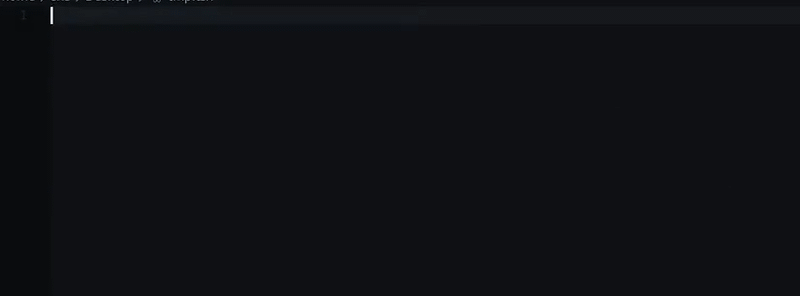

# Next.js Snippets

## Snippets

- `nlayout` — Root Layout
- `nglayout` — Nested Layout
- `nmetadata` — Static Metadata
- `ndmetadata` — Dynamic Metadata
- `nimage` — Image
- `nlink` — Link
- `npage` — Page
- `ngerror` — Global Error
- `nerror` — Error
- `nnotfound` — Not Found
- `nredirect` — Redirect
- `nxload` — Loading
- `nxslot` — Slot Component
- `nsc` — Server Component
- `ncc` — Client Component
- `nfetch` — Async Server-side Fetching
- `nparams` — Dynamic Route Params
- `nsparams` — Search Params
- `nsaction` — Server Action
- `nfaction` — Form Server Action